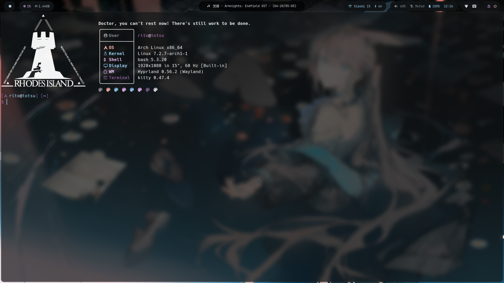
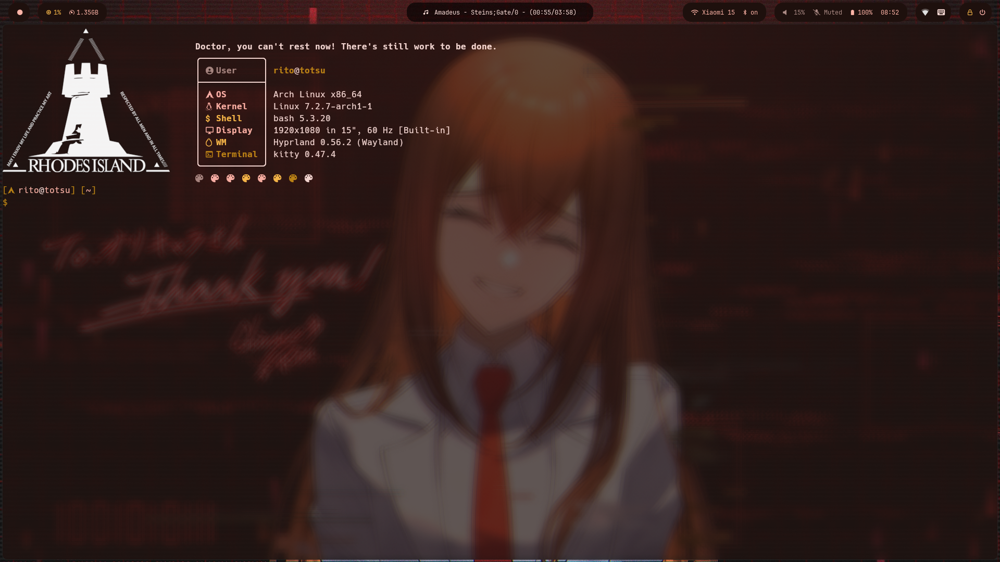
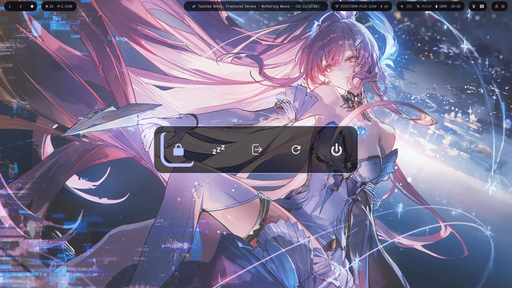
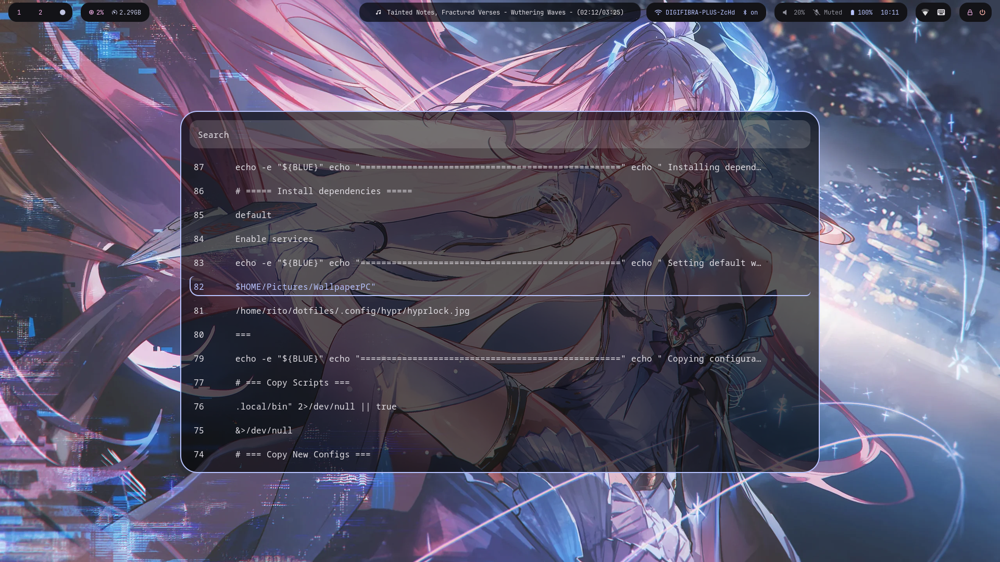

# Hyprland Dotfiles

My personal Arch Linux + Hyprland configuration, with dynamic theming based on the wallpaper.

## Requirements

- **Arch Linux** (or Arch-based distro)
- **Internet connection** (to install packages)
- **git** (`sudo pacman -S git`)

*Note: All other dependencies (Hyprland, UWSM, Waybar, etc.) are installed automatically by the `install` script.*

## Screenshots
### PREVIEW:



### Powermenu:


### Clipboard:


## What's Included

| Component | Description |
|-----------|-------------|
| `hypr` | Hyprland config (bindings, monitors, look & feel) |
| `waybar` | Status bar |
| `kitty` | Terminal emulator |
| `rofi` | Application launcher and menus |
| `dunst` | Notification daemon |
| `fastfetch` | System info tool |
| `mpd` | Music Player daemon |
| `skwd-wall` | Dynamic wallpaper manager with Matugen |

## Installation

### Automatic (recommended)

```
git clone https://github.com/totsurito/totsu-hyprdots.git ~/dotfiles
cd ~/dotfiles
chmod +x install
./install
```

The installer will:

1. Check if you're on Arch Linux.
2. Install yay if you don't have an AUR helper.
3. Install all required packages (official + AUR).
4. Back up your existing configs.
5. Copy the new configs to ~/.config/
6. Copy the scripts to ~/.local/bin/
7. Enable required services.
8. Apply a default wallpaper and generate themes.

### Manual

1. Clone the repository:
```
git clone https://github.com/totsurito/totsu-hyprdots.git ~/dotfiles
```
2. Copy the configs:
```
cp -r ~/dotfiles/.config/* ~/.config/
cp -r ~/dotfiles/.local/bin/* ~/.local/bin/
```
3. Give execute permissions to scripts:
```
chmod +x ~/.local/bin/*
```
4.Restart Hyprland or your computer.

## Dynamic Theming

This setup uses Matugen to generate color schemes from your wallpaper.
When you change your wallpaper with skwd-wall, the following apps update automatically:

- Hyprland
- Waybar
- Kitty
- Rofi

## Wallpapers

Place your wallpapers in:

```
~/Pictures/WallpaperPC/
```

Then use skwd-wall to select one. The themes will be generated automatically.

## Keybindings

| Keybinding | Action |
| -------- | -------- |
| SUPER + T | Terminal (Kitty) |
| SUPER + B | Browser (Zen Browser) |
| SUPER + F | File Manager |
| SUPER + A | App Launcher |
| SUPER + Q | Close Window |
| SUPER + W | Toggle Floating |
| SUPER CTRL + W | Wallpaper Picker |
| SUPER SHIFT + L | Lock Screen |
| SUPER + ESCAPE | Power Menu |

(More keybindings available in SUPER + /)

## Notes
- This dotfile was built on top of an existing one, with many customizations.
- Some scripts may be specific to my workflow.
- Feel free to fork it and adapt it to your needs.

## Credits
- Multiples scripts and configs are adapted from the community
